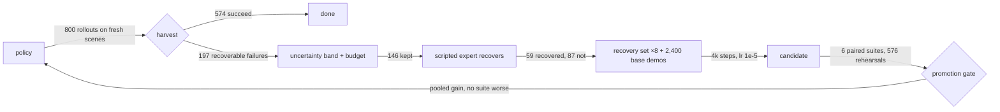
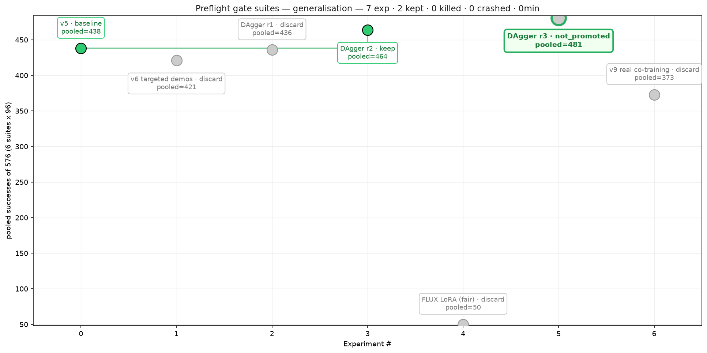
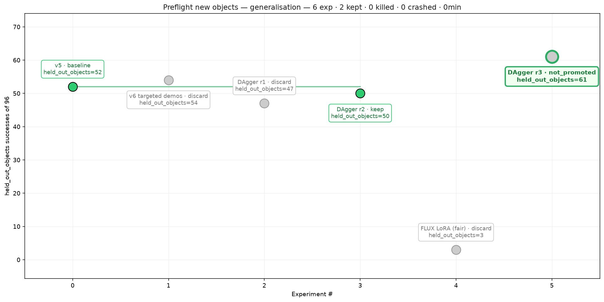

# Preflight

**Know whether a robot will succeed before it moves.** Entry for the [Nebius Global AI Hackathon](https://nebiusglobalaihackathon.devpost.com/) — **Physical AI track**.

> Build embodied and edge agents that sense and act in the real world: robotics, IoT, and on-device
> intelligence, powered by Nemotron, GR00T, Cosmos and Sonic models and coordinated through an agent
> runtime. Use Nebius Serverless Jobs to run simulations, generate synthetic data, evaluate robot
> policies, or process sensor data at scale, and Nebius Serverless Endpoints to serve real-time
> inference when needed.

## How Preflight uses Nebius and NVIDIA

A phone photographs the workspace, the scene is rebuilt as a MuJoCo twin of the SO-101 arm, a GR00T policy rehearses
the task dozens of times across randomised variants, and the calibrated success rate becomes a **GO / RETRY / ASK_HUMAN**
verdict that a Nemotron agent explains.

| Stage | Model | Runs on | Code |
|---|---|---|---|
| Verdict explanation | **Nemotron 3 Ultra** (Super / 3.5 Lightning selectable) | **Nebius Token Factory**, called on every verdict | [`NemotronAgent`](src/nebius_physical_ai/pipeline.py) |
| Scene perception | **Cosmos 3** Reasoner, with a Token Factory VLM as an alternative | our GPU (vLLM) or **Nebius Token Factory** | [`CosmosClient`, `TokenFactoryVLClient`](src/nebius_physical_ai/pipeline.py), [`scripts/cosmos_local.sh`](scripts/cosmos_local.sh) |
| Policy | **GR00T N1.7**: DAgger round 3 (v5 plus three rounds of on-policy expert recoveries), fine-tuned from [hqfang/groot-so100_101](https://huggingface.co/hqfang/groot-so100_101); GR00T N1.6 for v1–v4c | our A100 | [`scripts/lerobot_policy_server.py`](scripts/lerobot_policy_server.py), [`scripts/finetune.py`](scripts/finetune.py) |
| Rehearsal, benchmark, trust score | — | our A100 (MuJoCo, headless) | [`twin/`](src/nebius_physical_ai/twin), [`benchmark.py`](src/nebius_physical_ai/benchmark.py), [`trust/`](src/nebius_physical_ai/trust) |

Every verdict makes a runtime call to Token Factory; without a `NEBIUS_API_KEY` the explanation step fails rather than
falling back to canned text (`--offline-explain` exists for offline tests only). GR00T and Cosmos run on our own GPU,
which the [FAQ](https://nebiusglobalaihackathon.devpost.com/details/faqs) allows alongside a Token Factory call. Model
weights are downloaded from Hugging Face and run by us; no NVIDIA model is reached through a third-party inference
provider. Submission status: [`docs/hackathon-rules.md`](docs/hackathon-rules.md#submission-checklist).

## Quickstart

```bash
uv sync
cp .env.example .env   # fill in Nebius / Tavily keys
uv run npai info
uv run pytest
```

Hackathon rules digest: [`docs/hackathon-rules.md`](docs/hackathon-rules.md). Design spec: [`docs/specs/2026-09-30-preflight-design.md`](docs/specs/2026-09-30-preflight-design.md).

## Policy

The served policy is **DAgger round 3**: [hqfang/groot-so100_101](https://huggingface.co/hqfang/groot-so100_101)
(GR00T N1.7, pretrained on 1,209 SO-100/101 datasets) fine-tuned with LeRobot on 800 scripted twin demos (**v5**), then
on the expert's recoveries from the policy's own failure states, three rounds deep ([`scripts/dagger_round.sh`](scripts/dagger_round.sh)). Rounds 2
and 3 each passed the promotion gate; see [Generalisation results](#generalisation-results).
All results are in simulation: **the physical arm has not been delivered yet, and the repo will be updated with
live-arm results when it arrives.**

Both are LeRobot checkpoints, served by [`scripts/lerobot_policy_server.py`](scripts/lerobot_policy_server.py),
which speaks the Isaac-GR00T ZeroMQ protocol: the rehearsal, benchmark and verdict code talk to it exactly as to an
Isaac-GR00T server. It runs in its own LeRobot environment on a GPU host:

```bash
uv venv ~/lerobot-n17/.venv --python 3.12
uv pip install --python ~/lerobot-n17/.venv/bin/python "lerobot[groot,training]==0.6.1"   # keeps wandb below 0.28
CKPT=~/checkpoints/gr00t-preflight-dagger-r3/checkpoints/004000/pretrained_model   # or gr00t-preflight-v5/checkpoints/012000
ln -sfn ~/checkpoints/hqfang-groot-so100_101/vlm_processor "$CKPT/vlm_processor"   # saved checkpoints omit it
~/lerobot-n17/.venv/bin/python scripts/lerobot_policy_server.py "$CKPT" --port 5558
```

Reproducing v5 from the base checkpoint: convert the demos to LeRobot v3.0 ([`scripts/episode_stats.py`](scripts/episode_stats.py)
then `lerobot.scripts.convert_dataset_v21_to_v30`), recompute the checkpoint's joint normalisation from them
([`scripts/restat_checkpoint.py`](scripts/restat_checkpoint.py): the base pools its statistics in degrees, the twin
records LeRobot units), then `lerobot-train --policy.path=<re-statted checkpoint>` with the front and wrist cameras
renamed to `camera_0` and `camera_1`. A DAgger round then harvests the policy's failures, records expert recoveries,
fine-tunes and gates the candidate: `bash scripts/dagger_round.sh` (state in `logs/dagger/state.env`, resumable with
`STAGE=harvest|aggregate|train|bench`). Isaac-GR00T fine-tunes (v1 to v4c) are served with `scripts/finetune.py serve`.

## Generalisation results

Every candidate is scored on six paired suites of 96 rehearsals (the same scenes for every checkpoint) and compared
scene by scene with McNemar tests; a candidate is promoted only with a pooled gain and no suite worse.

| Policy | Pooled (of 576) | held_out_objects (of 96) | so101-benchmark | Verdict |
|---|---|---|---|---|
| v5 | 438 | 52 | 0/50 | baseline |
| DAgger round 1 (recoveries 3.5% of training) | 436 | 47 | — | kept, within noise |
| DAgger round 2 (recoveries ~34%) | 464 | 50 | — | promoted (+26; real_1_pomade_tin 74 → 86, p=0.004) |
| DAgger round 3, first run | 481 | 61 | — | kept: pooled +17 within noise; held_out_objects 50 → 61 (p=0.043) |
| **DAgger round 3, retrained** | **483** | **57** | — | **promoted** (+19 over round 2; the pooled gain replicates) |
| DAgger round 4 (residual RL expert records recoveries) | 471 | 49 | — | kept: −12 vs round 3, within noise |
| DAgger round 5 (RL recoveries weighted ×2) | 455 | 41 | — | worse on held_out_objects (p=0.004); RL-recovery line closed |
| Best-of-8 chunk consensus on round 2 (2 suites) | — | 55 | — | within noise (p=0.41); not adopted |
| DiVeR verifier best-of-8 on round 3 (2 suites) | — | 54 | — | within noise (p=0.66; clean_many 85 vs 88); best-of-N closed ([#30](https://github.com/charleneleong-ai/nebius-physical-ai/pull/30)) |
| DiVeR on the action expert's per-candidate state (2 suites) | — | 48 | — | worse (p=0.049) ([#31](https://github.com/charleneleong-ai/nebius-physical-ai/pull/31)) |
| DiVeR with 305 real ArmnetBench outcomes (2 suites) | — | 52 | — | within noise (p=0.33) ([#31](https://github.com/charleneleong-ai/nebius-physical-ai/pull/31)) |
| v9: + 400 real ArmnetBench demos (23% of samples) | 373 | 48 | 0/50 | worse on 3 suites (p≤0.043); dropped |
| v11: round 3 + 87 joint-calibrated block-stacking real episodes (9%) | 472 | 57 | — | within noise on every suite; kept for the real arm ([#29](https://github.com/charleneleong-ai/nebius-physical-ai/pull/29)) |
| FLUX 3 Action LoRA, fair (v5's data and volume) | 50 | 3 | 0/7 | worse on every suite; dropped |



The funnel above is round 3 (harvested with round 2). Retrained, round 3 scores 483 (first run 481) and is promoted;
held_out_objects sits above round 2 in both runs (61 and 57 vs 50), though not significant on its own in the retrain.
The external benchmark is still 0–1/50. In round 4 a residual RL expert recorded the recoveries (88 of 120 kept
states, 73%, against the script's 40%), but the extra recoveries did not improve the policy (471 vs 483). Round 5 weighted them ×2 instead of ×8 and new
objects fell further (41 vs 57, p=0.004), so RL-expert recoveries are dropped and round 3 stays served. Latest literature sweep:
[`reports/so101-generalisation-sota-2026-10-11.md`](reports/so101-generalisation-sota-2026-10-11.md).


 Full method, every denominator and what is not yet established: [`docs/report.pdf`](docs/report.pdf)
([source](docs/report.tex)), [`docs/experiment-card.md`](docs/experiment-card.md) and
[`docs/generalisation-diagnosis.md`](docs/generalisation-diagnosis.md); runs and videos in the
[W&B report](https://wandb.ai/chaleong/preflight/reports/Preflight:-SO-101-generalisation-experiments--VmlldzoxODA5MDQ3Mg==). A one-page summary: [Preflight Generalisation Ledger](https://claude.ai/artifact/JUihdgT9xtqYc8a4ieJPQU) ([HTML](docs/artifact.html)).

Long runs report progress per case: a rich bar at a terminal, a timestamped line with successes and ETA in nohup logs,
and running counts in W&B, so a suite that takes hours on a shared GPU is visible throughout.

## Licences

This repository's code is [Apache-2.0](LICENSE). The model weights are not covered by it:

- **v5 and its base** derive from [nvidia/GR00T-N1.7-3B](https://huggingface.co/nvidia/GR00T-N1.7-3B) and are under the
  NVIDIA licence that comes with it, which restricts use to research and evaluation. They are not redistributed here.
- **v1 to v4c** derive from GR00T N1.6 via the community checkpoint
  [quangnd58/GR00T-N1.6-3B-so101-multitask](https://huggingface.co/quangnd58/GR00T-N1.6-3B-so101-multitask), under the
  terms of its base model.
- **Cosmos 3** and **Nemotron** are used under their own NVIDIA model licences; Nemotron is called through Nebius Token
  Factory.
- **FLUX 3 Action** was evaluated only ([#18](https://github.com/charleneleong-ai/nebius-physical-ai/pull/18)) under
  the FLUX Kommunity (non-commercial) licence; no FLUX weights or outputs are part of the submission.
- **ArmnetBench** ([armnet/armnetbench_v01_lerobot_so101](https://huggingface.co/datasets/armnet/armnetbench_v01_lerobot_so101))
  is Apache-2.0; used for co-training experiments, not redistributed.

## Closed-loop learning architecture

The next architecture step is a closed-loop SO-101 learner: a world-model layer predicts candidate outcomes, GR00T executes short action chunks behind a safety controller (FLUX 3 Action was evaluated for this role and dropped: it fails closed-loop), and failures feed an asynchronous DAgger/recovery loop. The current evidence and open work are summarised in [`docs/closed-loop-architecture.md`](docs/closed-loop-architecture.md), with the Mermaid source in [`docs/specs/2026-10-09-closed-loop-world-model-architecture.mmd`](docs/specs/2026-10-09-closed-loop-world-model-architecture.mmd).
