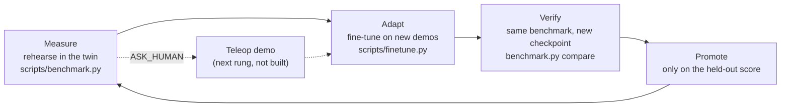

# The capability ladder

Preflight answers one question before the arm moves: will this attempt work? The longer aim is an arm that adapts to new
scenes and tasks with less time and friction, and a way to know when to trust it. That is a loop with four stages. Each
stage has a tool in this repo, and one stage is still manual.

## What each stage means here

- **Measure.** `npai preflight` rehearses one scene. `scripts/benchmark.py` scores a whole checkpoint on fixed suites, 96
  rehearsals per cell at seed 42.
- **Adapt.** `scripts/finetune.py run NAME` records scripted demos in the twin and fine-tunes GR00T. This is batch
  fine-tuning, not weights changing during a run.
- **Verify.** `scripts/benchmark.py compare` calls a checkpoint better or worse only when the 95% intervals do not
  overlap. The same scene moves by about 8 of 48 between runs, so anything smaller is noise.
- **Promote.** A checkpoint replaces the served one only if its held-out score beats the last, never on the clean-pair
  score alone.

## Zero-shot and few-shot, as measured here

- **Zero-shot** is the `held_out` suites: colours (`mint`, `lime`), sizes beyond the training ranges, and real objects
  (`glasses_case`, `ball_cluster`) that no training episode contains. The split lives in `twin/roles.py` and is shared by
  the randomiser and the benchmark, so a training run cannot see what the benchmark holds out.
- **Few-shot** is a fine-tune of a checkpoint on `k` scripted demos of one held-out object, scored on that object. The
  arm is not built yet, so the demos are the scripted expert's, not a person's.

## What is not built

- Updating weights while the arm runs. GR00T fine-tuning is batch; the realistic version is the staged loop above.
- Turning an ASK_HUMAN verdict into a teleop demo and then a fine-tune. The verdict exists; the hand-off does not.
- Targeted demos from failures. Today the demo distribution is set by hand (`twin/randomize.py`); the loop would pick it
  from what the benchmark missed.
- The scripted expert only knows pick-and-place by top-down grasp. New skills (push, open, pour) need their own expert
  or real demos.

## Notes on the benchmark

- Generated scenes are kept only when the scripted expert solves them, so a miss is the policy's. The number of scenes the
  expert rejected is printed with each suite.
- Success is judged on the named pair of blocks. Stacking the wrong object is a failure, because `StackCheck(pick, place)`
  looks up the blocks by the names in the prompt.
- Pick objects are always synthetic: the real objects are wider than the gripper opens. Real objects appear as place
  targets and clutter.
- The legacy suites rebuild the v2 and v3 cells exactly (the blue and red cubes from 65 degrees, real objects as clutter,
  an azimuth sweep), so a new checkpoint can be put beside the old numbers. Run `scripts/benchmark.py run` on v3 first and
  check it reproduces them within noise before trusting a comparison.
- Benchmark scenes come from their own random streams, apart from the demos' (`[42, k]` against `42`).
- This is a twin benchmark. It is not a published SO-101 benchmark, and a high score here is a statement about the sim.
