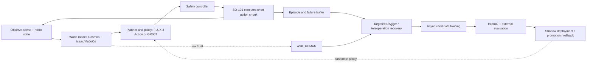

# Closed-loop world-model learning architecture

Preflight is evolving from a pre-execution verifier into a closed-loop learning system for the SO-101: observe the workspace, predict the likely outcomes of candidate actions, execute a short action chunk, inspect what happened, recover safely, and use the resulting episode to improve future behaviour.

The target architecture is shown in [`specs/2026-10-09-closed-loop-world-model-architecture.mmd`](specs/2026-10-09-closed-loop-world-model-architecture.mmd).

## Component boundaries

- **Perception and state estimation:** camera observations, ArUco geometry, object/task state, joint state, and confidence.
- **World model:** Cosmos 3 Nano supplies visual future/scenario hypotheses; Isaac Sim/MuJoCo supplies physically grounded contacts, reachability, and counterfactual rollouts. Cosmos is not assumed to be a reliable source of low-level action labels by itself.
- **Action policy:** FLUX 3 Action and GR00T remain interchangeable policy backends. They propose short action chunks; they do not own safety limits.
- **Safety controller:** enforces joint, velocity, force, workspace, collision, and emergency-stop constraints on every physical action.
- **Continual learner:** stores real outcomes and failures, requests expert/teleoperation recoveries, trains candidates asynchronously, and promotes only benchmarked candidates.

The real-time path should be split into two timescales:

1. A fast control loop executes and replans short action chunks.
2. A slower world-model and learning loop scores alternatives, records failures, trains candidates, and updates the deployed policy only after a promotion gate.

Uncontrolled weight updates during physical execution are explicitly out of scope. Online learning means online experience collection, recovery, and candidate improvement; deployment remains gated and reversible.

## Progress to date

| Workstream | Evidence | State |
|---|---|---|
| v5 GR00T N1.7 baseline | [PR #11](https://github.com/charleneleong-ai/nebius-physical-ai/pull/11): v5 reaches 55–82/96 across the paired internal suites and 57% on the held-out-object headline reported in the repository | Established simulation baseline |
| Failure diagnosis | [PR #12](https://github.com/charleneleong-ai/nebius-physical-ai/pull/12): 138 failures classified across 576 rehearsals; `no_contact` is the largest class | Established |
| Targeted demonstrations | [PR #13](https://github.com/charleneleong-ai/nebius-physical-ai/pull/13): v6 recovery/decoy data changes failure mix but does not beat v5 overall | Evaluated; not promoted |
| External benchmark | [PR #14](https://github.com/charleneleong-ai/nebius-physical-ai/pull/14): v5 scores 0/50 externally versus 77–86% in the twin | Visual-contract gap identified |
| DAgger loop | [PR #15](https://github.com/charleneleong-ai/nebius-physical-ai/pull/15): failure snapshots, uncertainty targeting, balanced recovery budget, gated promotion | Implemented; round 1 kept v5 |
| Uncertainty targeting | [PR #16](https://github.com/charleneleong-ai/nebius-physical-ai/pull/16): uncertainty/failure-balanced harvesting replaces indiscriminate replay | Implemented |
| Visual domain randomisation | [PR #17](https://github.com/charleneleong-ai/nebius-physical-ai/pull/17): Seeed-mount score improves 15→53/96, but internal clean score regresses 81→58; external score only 1/50 | Diagnostic fix; not promoted |
| FLUX 3 Action | [PR #18](https://github.com/charleneleong-ai/nebius-physical-ai/pull/18): 0/10 external and 0/16 initial internal zero-shot evaluation | Evaluated; adaptation pending |

The current evidence supports a conservative conclusion: the system has a working simulation, evaluation, failure-harvesting, and promotion foundation, but it does not yet have a validated learned world model controlling the real arm or a demonstrated online policy-improvement loop on hardware.

## Next validation milestones

1. Re-run v5 and the visual-DR candidate on the same internal appearance suites and external benchmark.
2. Fine-tune FLUX and score it on exactly the same paired suites.
3. Add world-model prediction in shadow mode before allowing it to select physical actions.
4. Connect real SO-101 outcomes to the episode buffer and teleoperation recovery path.
5. Promote candidates only when internal, appearance, and external scores improve without regression on the served suites.

## Open PRs

The implementation work remains distributed across the stacked PRs above. This architecture PR is documentation-only: it records how those efforts compose into the eventual closed-loop system and does not claim that the real-arm or online-learning milestones are complete.
