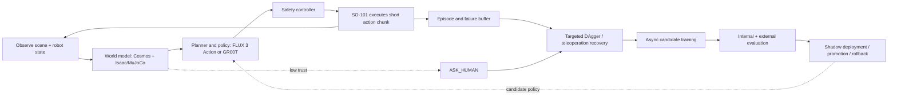

# Closed-loop world-model learning architecture

Preflight is evolving from a pre-execution verifier into a closed-loop learning system for the SO-101: observe the workspace, predict the likely outcomes of candidate actions, execute a short action chunk, inspect what happened, recover safely, and use the resulting episode to improve future behaviour.

The target architecture is shown in [`specs/2026-10-09-closed-loop-world-model-architecture.mmd`](specs/2026-10-09-closed-loop-world-model-architecture.mmd).

## Component boundaries

- **Perception and state estimation:** camera observations, ArUco geometry, object/task state, joint state, and confidence.
- **World model:** Cosmos 3 Nano supplies visual future/scenario hypotheses; Isaac Sim/MuJoCo supplies physically grounded contacts, reachability, and counterfactual rollouts. Cosmos is not assumed to be a reliable source of low-level action labels by itself.
- **Action policy:** FLUX 3 Action and GR00T remain interchangeable policy backends. They propose short action chunks; they do not own safety limits.
- **Safety controller:** enforces joint, velocity, force, workspace, collision, and emergency-stop constraints on every physical action.
- **Continual learner:** stores real outcomes and failures, requests expert/teleoperation recoveries, trains candidates asynchronously, and promotes only benchmarked candidates.

The real-time path should be split into two timescales:

1. A fast control loop executes and replans short action chunks.
2. A slower world-model and learning loop scores alternatives, records failures, trains candidates, and updates the deployed policy only after a promotion gate.

Uncontrolled weight updates during physical execution are explicitly out of scope. Online learning means online experience collection, recovery, and candidate improvement; deployment remains gated and reversible.

## Progress to date

| Workstream | Evidence | State |
|---|---|---|
| v5 GR00T N1.7 baseline | [PR #11](https://github.com/charleneleong-ai/nebius-physical-ai/pull/11): v5 reaches 55–82/96 across the paired internal suites and 57% on the held-out-object headline reported in the repository | Established simulation baseline |
| Failure diagnosis | [PR #12](https://github.com/charleneleong-ai/nebius-physical-ai/pull/12): 138 failures classified across 576 rehearsals; `no_contact` is the largest class | Established |
| Targeted demonstrations | [PR #13](https://github.com/charleneleong-ai/nebius-physical-ai/pull/13): v6 recovery/decoy data changes failure mix but does not beat v5 overall | Evaluated; not promoted |
| External benchmark | [PR #14](https://github.com/charleneleong-ai/nebius-physical-ai/pull/14): v5 scores 0/50 externally versus 77–86% in the twin | Visual-contract gap identified |
| DAgger loop | [PR #15](https://github.com/charleneleong-ai/nebius-physical-ai/pull/15): failure snapshots, uncertainty targeting, balanced recovery budget, gated promotion | Implemented; round 1 kept v5 |
| Uncertainty targeting | [PR #16](https://github.com/charleneleong-ai/nebius-physical-ai/pull/16): uncertainty/failure-balanced harvesting replaces indiscriminate replay | Implemented |
| Visual domain randomisation | [PR #17](https://github.com/charleneleong-ai/nebius-physical-ai/pull/17): Seeed-mount score improves 15→53/96, but internal clean score regresses 81→58; external score only 1/50 | Diagnostic fix; not promoted |
| FLUX 3 Action | [PR #18](https://github.com/charleneleong-ai/nebius-physical-ai/pull/18): 0/10 external and 0/16 initial internal zero-shot evaluation | Evaluated; adaptation pending |

The current evidence supports a conservative conclusion: the system has a working simulation, evaluation, failure-harvesting, and promotion foundation, but it does not yet have a validated learned world model controlling the real arm or a demonstrated online policy-improvement loop on hardware.

## What is already built

The work completed so far forms the lower half of the closed loop:

1. **Scene capture and state estimation.** Phone capture, ArUco mat localisation, camera calibration, marker-corrected object geometry, configurable tasks, and Cosmos/Token Factory perception are implemented.
2. **A physically grounded twin.** The SO-101 MuJoCo twin renders the task, randomises physics/cameras/objects/appearance, and records LeRobot-compatible demonstrations.
3. **Policy serving and control.** GR00T N1.6/N1.7 checkpoints are served through a common policy interface; FLUX 3 Action has a separate evaluator and dataset bridge.
4. **Internal evaluation.** Paired multi-scene suites, held-out objects, failure labels, Wilson intervals, McNemar comparisons, W&B media, and promotion gates are implemented.
5. **External evaluation.** The independent `so101-benchmark` runner exposed a 0/50 v5 visual-contract failure, which led to the textured-floor and wrist-mount appearance suites.
6. **Targeted improvement.** v6 recovery/decoy demonstrations and the uncertainty-targeted DAgger loop now harvest failures, record recoveries, rebalance the data, train candidates, and gate promotion.
7. **Trust and intervention.** Preflight produces GO / RETRY / ASK_HUMAN decisions and can explain them through the Nebius Token Factory path.

The strongest measured result is the v5 GR00T N1.7 baseline: 55–82 successes out of 96 across the paired internal suites, 57% on the held-out-object headline reported in the repository, and 0/50 on the external benchmark. That gap is now a measured diagnosis rather than an unexplained failure.

## Measured path to the end state

Each stage should produce a result before the next stage is promoted.

| Step | Capability to add | Experiment | Metric / gate |
|---|---|---|---|
| 1 | Stable baseline | Re-run v5 on fixed internal, appearance, and external suites | Store successes, failures, 95% intervals, latency, and exact checkpoint/config; no promotion without reproducibility |
| 2 | Visual generalisation | Compare v5, visual-DR v7, and a fresh base-trained candidate on held-out textures and wrist mounts | Improve the external score without regressing the six internal suites; report paired McNemar results |
| 3 | Policy comparison | Score GR00T and FLUX on identical datasets, seeds, cameras, and action contracts | Select by paired success, failure mix, latency, memory, and recovery rate—not headline success alone |
| 4 | World-model shadow mode | Give Cosmos and Isaac/MuJoCo candidate action chunks but do not let them control the arm | Calibration of predicted outcome vs rollout outcome; zero effect on physical control until the predictor is validated |
| 5 | Closed-loop recovery | Execute short action chunks, detect failure types, replan, and invoke a scripted or human recovery | Recovery success, time-to-recovery, collision/force violations, and intervention rate; safety violations must remain zero |
| 6 | Real episode buffer | Record real observations, actions, state, outcome, uncertainty, and human intervention | Every episode is replayable and labelled; no unverified or corrupted episode enters training |
| 7 | Continual-learning candidate | Train asynchronously on real data plus validated Isaac/Cosmos data and DAgger recoveries | Candidate must beat the served checkpoint on held-out internal and external suites and regress on none |
| 8 | Safe promotion | Shadow-run the candidate, canary it on a small real-task slice, and retain rollback | Promotion requires benchmark gate, canary success, bounded latency, and an immediate rollback path |

The order is deliberate: first make the measurements stable, then close the visual gap, then validate prediction, then enable physical recovery, and only after that allow online experience to influence deployed weights.

## Next validation milestones

The immediate next run is Step 1: produce one versioned result bundle for v5 containing all internal and external scores, failure breakdowns, environment/config fingerprints, and W&B links. That bundle becomes the reference for every subsequent candidate.

## Open PRs

The implementation work remains distributed across the stacked PRs above. This architecture PR is documentation-only: it records how those efforts compose into the eventual closed-loop system and does not claim that the real-arm or online-learning milestones are complete.
