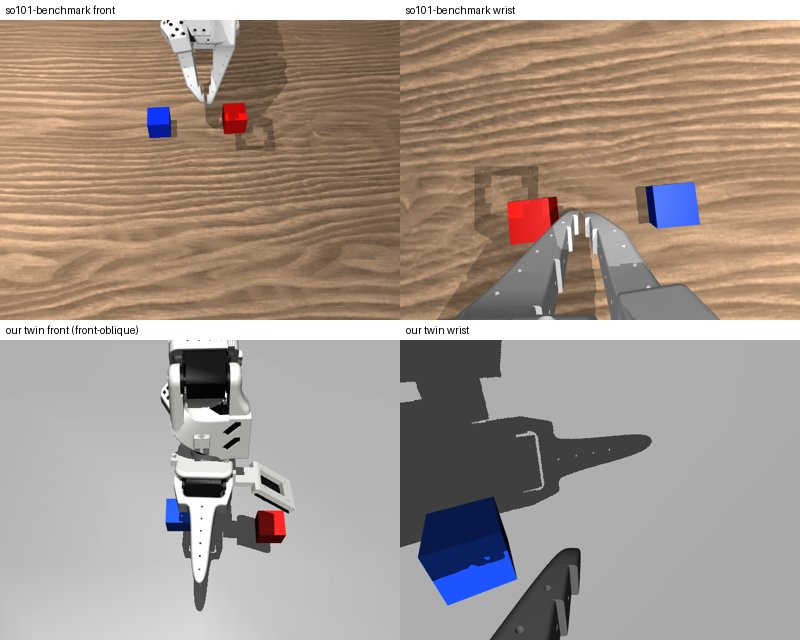

# Why v5 scores 0/50 on so101-benchmark

[`scripts/so101_bench_eval.py`](../../../scripts/so101_bench_eval.py) runs the served policy on
[so101-benchmark](https://github.com/Fatsharkovo/so101-benchmark)'s `stack_blue_on_red`. v5 scores 0/50, with every
episode timing out, while it stacks 77–86% of the time in our twin. The gap is in what the policy sees, not in the
joint mapping.

## Ruled out

- **Joint mapping.** Their joint limits match the menagerie ranges our twin maps LeRobot units onto, to four decimals
  (wrist roll's upper limit differs by 0.1 rad, never reached). Their home pose `[0, -70, 70, 60, 0, 0]` degrees,
  through their `to_sim`, becomes `[0, -70, 72.3, 63.2, -58, 0]` in our units, inside our training range.
- **Front camera.** Theirs sits 45 cm out, pitched 60° down and facing the robot (`pos 0.45 0 0.35`, fovy 45). That
  lies inside our arc randomisation (azimuth 0 = across the mat, elevation 35–80°, distance 35–65 cm).
- **Arm colour.** Their printed parts are 0.92 white, like ours.

## The gaps

1. **Table.** A wood-grain texture (`Wood049_1K_Color`) where our twin has only a flat grey floor (brightness
   0.45–0.7). v5 has never seen a textured surface.
2. **Wrist camera mount.** Theirs is the Seeed SO-ARM101 mount. In the gripper's own frame:

   | Mount | Position (m) | Tilt | fovy |
   |---|---|---|---|
   | Our menagerie mount | (−0.003, 0.054, −0.053) | 33° | 61° |
   | so101-benchmark's Seeed mount | (0.003, 0.071, −0.003) | 25° | 65° |

   Theirs is 5 cm higher and 2 cm further out, so it looks forward along both fingers. Ours looks down past one jaw.

## What the policy does

Probing one episode with the policy's raw chunks shows it reacts to the observation, but not to the cubes. It moves
straight to roughly our demos' start pose (shoulder lift −38, elbow 58) and then opens and closes the gripper in place
(14 → 49 → 72 → 63 → 35 → 15) for the rest of the episode. It never moves the arm towards either cube.

## Fix

Randomise both gaps in the demos, without training on the benchmark's own assets so its score stays an honest
generalisation test:
- procedural floor textures (wood grain, fabric noise, checker) in random colours, with the benchmark's texture never
  used;
- the wrist mount drawn between the menagerie and Seeed poses, with jitter;
- internal suites with held-out textures and the other mount, so the internal benchmark measures this axis too.
